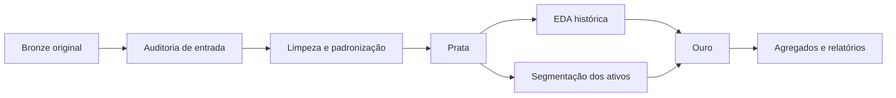

# Pipeline ETL e Data Quality

## Objetivo e arquitetura
Disponibilizar dados consistentes para a EDA e os três segmentos da Semana 5. Corte: 30/09/2026 às 23:59:59, Brasília. Processamento batch local em Python e Parquet. A ingestão inicial é manual; não há captura contínua de sistemas.

| Etapa | Implementação | Saída |
|---|---|---|
| Inventário e hashes | `src/auditar_bronze.py` | Manifesto e inventário |
| Tipagem, fuso e limpeza | `src/limpeza_qualidade_dados.py` | 12 tabelas Prata |
| EDA histórica | `src/processar_eda.py` | Uma linha por usuário/assinatura no snapshot observado |
| Marcos | `src/analisar_eda_marcos.py` | Churn mensal, campanha e correlação |
| Segmentação | `src/segmentacao_clientes.py` | Uma linha por pagante ativo no corte |
| Verificação da migração | `src/validar_engenharia_dados.py` | Comparação com baseline e logs privados |

## Qualidade e tratamentos
Ver o [registro oficial de tratamentos](../docs/registro_limpeza_tratamento_dados.md) para regras e quantidades históricas. As dimensões incluem completude, validade, consistência, unicidade e tempo. Hash preservado comprova conservação do arquivo, não correção do conteúdo. Testes aprovados também não comprovam causalidade.

Os scripts são a implementação. Este documento explica o fluxo; não deve conter cópias alternativas da limpeza. A EDA passa a consumir somente Prata. Auditorias de fonte podem consultar Bronze para medir o antes/depois.

## Controles de publicação
A validação da migração executa a EDA duas vezes em staging, verifica contratos e compara a Ouro candidata com a baseline. O argumento `--publicar` só substitui a EDA se a comparação passar sem mudanças de conteúdo. A substituição é atômica por arquivo; a cadeia completa ainda não possui transação entre todas as tabelas.

## Navegação
- [Contratos e relacionamentos](05_contratos_granularidade_relacionamentos.md)
- [Linhagem de métricas e atributos](06_linhagem_metricas_features.md)
- [Auditoria temporal](07_auditoria_temporal_coortes.md)
- [Reconciliação](08_reconciliacao_dados_indicadores.md)
- [Execução e recuperação](09_execucao_reprocessamento.md)
- [Guia de referência](../docs/guia_engenharia_de_dados_para_ia.md)
