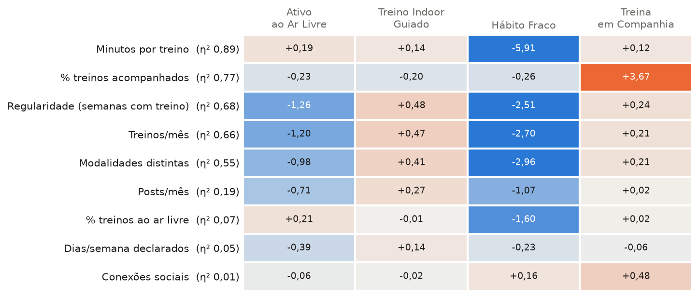
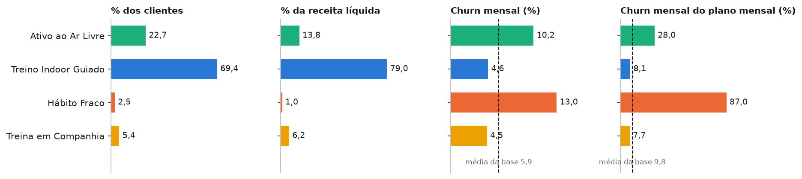
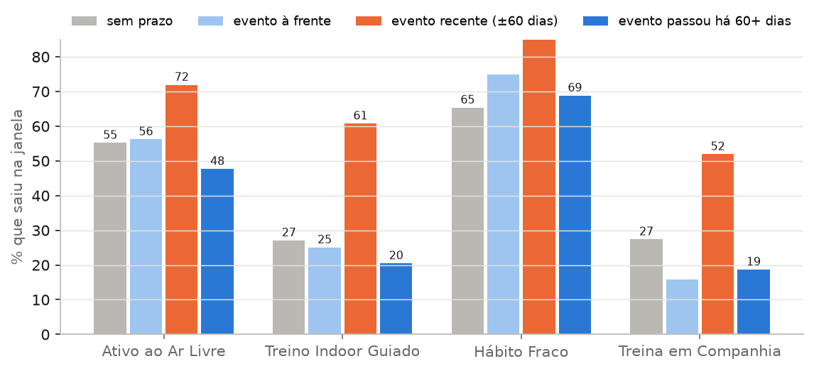
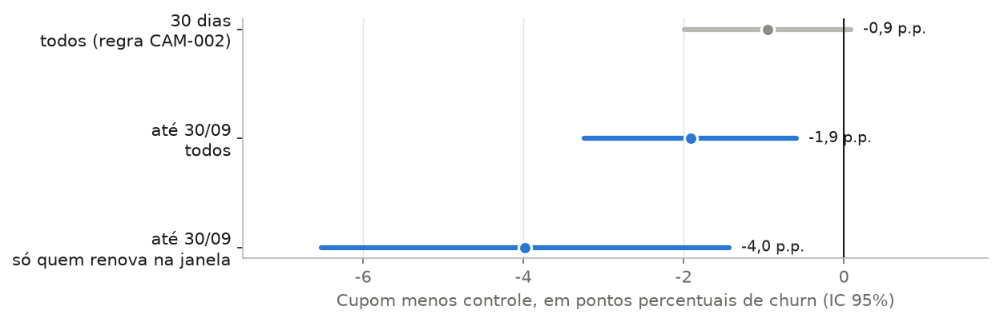

# Mini deck — Segmentação da base inteira (Semana 5)

> Proposta para discussão. Substitui os slides de segmentação do `mini_deck_eda_semana5.md` se o time aprovar.

---

## Slide 1 — A pergunta

Quem são os clientes da Vitaliza e onde está o risco de churn? Os grupos são formados **sem usar quem saiu**.

**Base:** 23.151 pagantes com assinatura em jan–set/2026, entre ativos e ex-clientes.

---

## Slide 2 — Por que não usar só os ativos

- 8.399 clientes saíram em 2026 e ficariam fora dos grupos.
- **Plano anual:** 57,5% dos ativos, contra 28,2% de quem saiu.
- Usar só os ativos esconde o mensalista sem hábito, que sai antes do corte.

---

## Slide 3 — Quatro formas de treinar

O que separa os grupos é **onde, quanto e com quem** a pessoa treina. Idade, sexo, UF e relógio não separam.

---

## Slide 4 — Tamanho, receita e risco

- **Hábito Fraco** tem o dobro do churn da base: 11,4% ao mês, e 39,9% no plano mensal.
- **Ativo ao Ar Livre** perde cerca de 470 clientes por mês, quase o mesmo número que o Hábito Fraco.

---

## Slide 5 — O objetivo acaba, o cliente vai embora

- 20% declaram um objetivo com data no onboarding.
- Perto do evento, 62% saem.
- Metade dos comentários da pesquisa de saída fala em “meta cumprida”, inclusive entre quem marcou “preço”.

---

## Slide 6 — O experimento já mostra um caminho

Entre quem tinha renovação até 30/09, o **cupom** reduziu o churn em 4,0 p.p., com IC 95% de −6,5 a −1,4.

---

## Slide 7 — Prioridades

| Imediata | Monitorar |
|---|---|
| 750 anuais do Hábito Fraco com renovação desligada | Falha de pagamento no Indoor e no Ar Livre |
| Primeiras 8 semanas do mensal novo | Conteúdo novo para o Indoor |
| 495 ativos com evento nos ±60 dias | Indicação e grupos no Treina em Companhia |

---

## Slide 8 — Limites

- **Separação moderada:** silhueta de 0,21.
- **Normalização:** a escolha (log1p + z-score) é uma premissa.
- **Cobertura:** só jan–set/2026; não cobre quem saiu em 2025.
- **Datas de evento:** vêm de regex e precisam de validação manual.
- **Natureza:** a análise é descritiva, sem causalidade nem previsão.
