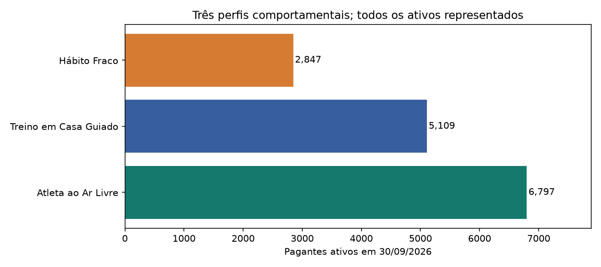
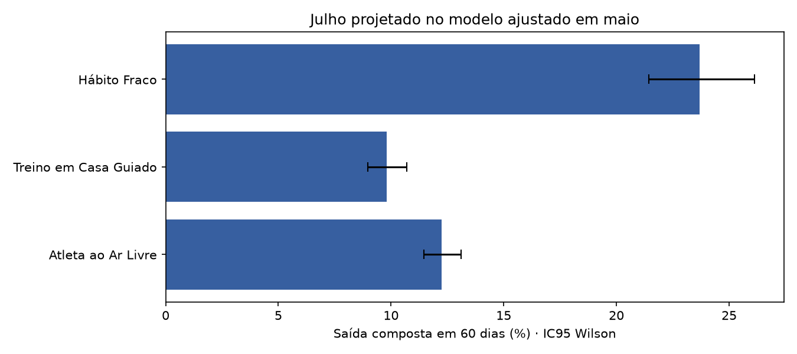

# Customer Segmentation Report — Semana 5

> Versão consolidada autoritativa, ADR 020. Corte: 30/09/2026. Gerado por src/consolidar_semana5.py.

## Retenção: segmentar, medir e testar

A série mensal reconstruída observa médias de 5,68% em 2025 e 6,68% em jan–set/2026. Abril registra 1.158 perdas contra 1.154 no case; divergência preservada, ainda sem causa reconciliada. O aumento após o reajuste não demonstra efeito causal de preço.

Cinco atributos: intenção de dias/semana, treinos por mês observado, regularidade, diversidade e proporção ao ar livre. Janela de 84 dias até cada corte; somente atividade dentro da assinatura. Mediana/P99/log1p/z-score são ajustados sem churn. Pessoas com menos de 30 dias são classificadas provisoriamente, mas permanecem nas contagens e desfechos.

| Perfil                |   Ativos |   Provisórios | Receita equivalente (R$/mês)   |
|:----------------------|---------:|--------------:|:-------------------------------|
| Atleta ao Ar Livre    |    6.797 |           524 | 193.706,80                     |
| Treino em Casa Guiado |    5.109 |           387 | 147.295,52                     |
| Hábito Fraco          |    2.847 |           208 | 64.548,77                      |

## Atleta ao Ar Livre

Contexto: Rotina predominantemente ao ar livre.

Conflito e limite: Hipótese: concluir uma meta pode reduzir o valor percebido da assinatura mesmo com treino frequente. Os registros atuais não comprovam esse motivo; a extração textual ainda requer validação humana.

Aprendizado: combinar comportamento com estado da assinatura; o perfil orienta a hipótese, mas não determina a resposta ao contato.

Decisão: Para elegíveis com renovação desligada, testar continuidade de treino versus controle, sem desconto automático; medir assinatura ativa com renovação ligada após 60 dias.

Evidência abaixo: carteira de setembro. A comparação de saída usa outra população, a coorte histórica da seção seguinte. Ampliar uma ação exige benefício líquido e ausência de dano; o piloto pequeno avalia viabilidade.

|   Ativos | Treinos/mês (mediana)   | Semanas com treino (%)   |   Renovação desligada |
|---------:|:------------------------|:-------------------------|----------------------:|
|    6.797 | 10,54                   | 91,67                    |                   319 |

## Treino em Casa Guiado

Contexto: Treinos registrados predominantemente em ambiente fechado; o nome da persona não prova uso de orientação guiada.

Conflito e limite: Hipótese: conteúdo pouco relevante ou dificuldade de encaixar a rotina pode reduzir a continuidade. A modalidade observada, sozinha, não comprova essas causas.

Aprendizado: combinar comportamento com estado da assinatura; o perfil orienta a hipótese, mas não determina a resposta ao contato.

Decisão: Para elegíveis com queda de regularidade, testar seleção editorial de conteúdo versus controle; medir retomada em 30 dias, saída em 60 dias e descadastro.

Evidência abaixo: carteira de setembro. A comparação de saída usa outra população, a coorte histórica da seção seguinte. Ampliar uma ação exige benefício líquido e ausência de dano; o piloto pequeno avalia viabilidade.

|   Ativos | Treinos/mês (mediana)   | Semanas com treino (%)   |   Renovação desligada |
|---------:|:------------------------|:-------------------------|----------------------:|
|    5.109 | 10,15                   | 91,67                    |                   221 |

## Hábito Fraco

Contexto: Pouca frequência e regularidade registradas.

Conflito e limite: Hipótese: dificuldade em formar rotina reduz valor percebido. Ausência de registro não revela lesão, motivação ou abandono de atividade física; contratos anuais adiam a perda financeira.

Aprendizado: combinar comportamento com estado da assinatura; o perfil orienta a hipótese, mas não determina a resposta ao contato.

Decisão: Separar mensal em formação de hábito, renovação já desligada e anual que renova. Testar rotina inicial de treino entre elegíveis versus controle; medir retomada em 30 dias e continuidade em 60 dias.

Evidência abaixo: carteira de setembro. A comparação de saída usa outra população, a coorte histórica da seção seguinte. Ampliar uma ação exige benefício líquido e ausência de dano; o piloto pequeno avalia viabilidade.

|   Ativos | Treinos/mês (mediana)   | Semanas com treino (%)   |   Renovação desligada |
|---------:|:------------------------|:-------------------------|----------------------:|
|    2.847 | 0,36                    | 8,33                     |                 1.715 |

## Evidência histórica e campanha

Maio ajusta transformações e K-Means; julho usa o modelo congelado antes de observar os 60 dias seguintes, até 29/09. População primária: ativos com renovação ligada no início. Saída composta: sem acesso ou renovação desligada no fim. As taxas são históricas, sob as campanhas que ocorreram no período, não risco individual atual nem efeito causal. Setembro tem seu próprio ajuste descritivo; não transferimos automaticamente as taxas de julho à carteira atual.

Campanha primária: todos os sorteados em 10/08, expiração no intervalo [10/08,09/09). ICs não simultâneos; p ajustado para três comparações. Não significância não comprova ausência de efeito. Sensibilidades por plano, 51 dias e saída composta constam nas tabelas e têm correção separada para múltiplas comparações.

| Perfil                |   Pessoas |   Saídas | Taxa (%)   | IC95 inferior   | IC95 superior   | Cobertura das saídas (%)   |
|:----------------------|----------:|---------:|:-----------|:----------------|:----------------|:---------------------------|
| Atleta ao Ar Livre    |     5.957 |  730     | 12,25      | 11,45           | 13,11           | 49,73                      |
| Treino em Casa Guiado |     4.458 |  437     | 9,80       | 8,96            | 10,71           | 29,77                      |
| Hábito Fraco          |     1.27  |  301     | 23,70      | 21,44           | 26,12           | 20,50                      |
| Base                  |    11.685 |    1.468 | 12,56      | 11,97           | 13,18           | 100,00                     |

## Prioridades, viabilidade e limites

Prioridades são regras operacionais, não classes causais de persuadíveis ou sleeping dogs. Verificar elegibilidade e preferências de contato; atendimento necessário não é negado.

Piloto proposto: até 400 elegíveis com renovação desligada, estratificados por plano e persona; 200 e-mails editoriais e 200 controles. Custo R$ 2; sem desconto, WhatsApp, CS proativo ou API. Desfecho: ativa com renovação ligada em 60 dias; retomada em 30 dias e reclamações são secundários. Não executado. Se faltarem elegíveis, reduzir os dois braços igualmente. Dimensionar amostra antes de expandir. Cenários financeiros são hipóteses, não ROI comprovado.

Pesquisa: 353 respondentes entre 3.389 saídas de junho–setembro (~10,4%); 641 respondentes totais incluem ativos. Motivos Web não representam lojas. Datas em textos não orientam ação até validação manual. Receita equivalente não é margem nem receita em risco.

Qualidade: silhueta 0.350; bootstrap com todo pré-processamento reajustado, ARI médio 0.998. Cinco atributos não descrevem necessidades individuais; cortes com menos de 30 dias têm atribuição provisória.

| Prioridade operacional               |   Clientes | Receita equivalente (R$/mês)   |
|:-------------------------------------|-----------:|:-------------------------------|
| 1 Diagnóstico da renovação desligada |      2.255 | 51.065,27                      |
| 2 Formação de hábito mensal          |    208     | 7.344,00                       |
| 3 Investigar antes de contato        |    924     | 20.015,80                      |
| 4 Monitorar continuidade             |     11.366 | 327.126,01                     |

## Campanha primária

| Braço    |   Pessoas |   Expirações | Taxa (%)   | Diferença (p.p.)   | IC95 inferior   | IC95 superior   | p ajustado   |
|:---------|----------:|-------------:|:-----------|:-------------------|:----------------|:----------------|:-------------|
| controle |     3.579 |          196 | 5,48       | 0,00               | 0,00            | 0,00            | —            |
| cupom    |     3.472 |          161 | 4,64       | -0,84              | -1,86           | 0,18            | 0,32         |
| desafio  |     3.515 |          182 | 5,18       | -0,30              | -1,34           | 0,75            | 1,00         |
| conteudo |     3.554 |          218 | 6,13       | 0,66               | -0,43           | 1,74            | 0,71         |

## Cenários de contribuição — hipóteses, não previsão

| tratados   | controle   | horizonte_meses   | delta_retencao_assumido   | receita_liquida_mensal_assumida   | custo_servir_mensal   | custo_contato   | custo_oferta   | custo_api   | contribuicao_incremental   |
|:-----------|:-----------|:------------------|:--------------------------|:----------------------------------|:----------------------|:----------------|:---------------|:------------|:---------------------------|
| 200,00     | 200,00     | 3,00              | -0,02                     | 27,49                             | 4,20                  | 2,00            | 0,00           | 0,00        | -281,48                    |
| 200,00     | 200,00     | 3,00              | 0,00                      | 27,49                             | 4,20                  | 2,00            | 0,00           | 0,00        | -2,00                      |
| 200,00     | 200,00     | 3,00              | 0,02                      | 27,49                             | 4,20                  | 2,00            | 0,00           | 0,00        | 277,48                     |
| 200,00     | 200,00     | 3,00              | 0,05                      | 27,49                             | 4,20                  | 2,00            | 0,00           | 0,00        | 696,70                     |

Receita líquida mensal assumida R$ 27,49; custo de servir R$ 4,20; permanência incremental assumida de três meses. Não somar CAC evitado sem demonstrar redução real de aquisição. API e ofertas são zero porque este piloto é editorial. Uma expansão exige custo oficial de API e contabilização dos compromissos futuros.

## Rastreabilidade

Tabelas completas e QA em `semana5_consolidada/tabelas/`. Método e reprodução em `../notebooks/12_consolidacao_semana5.md`. Gráficos, modelos e números anteriores são históricos, não devem ser misturados com esta versão.