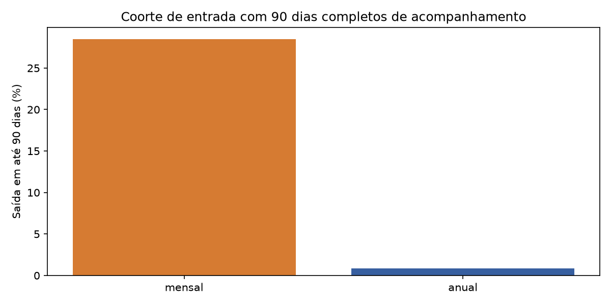
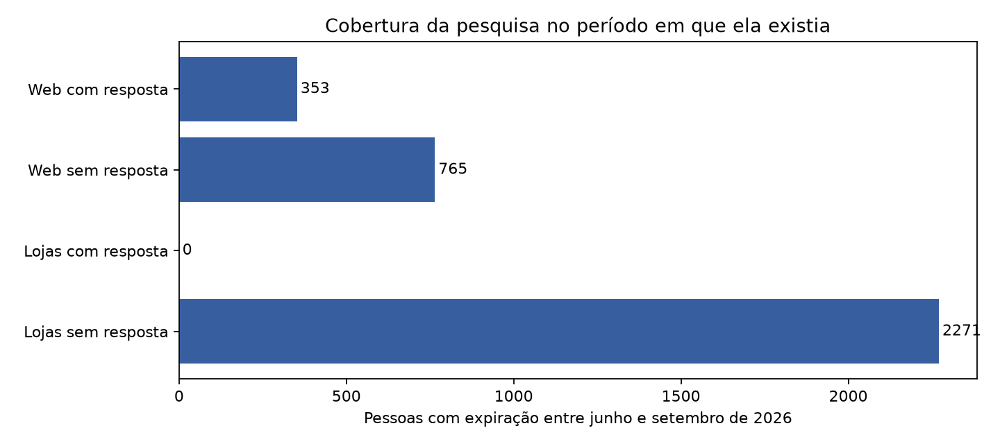

# EDA — interpretação consolidada, ADR 020

O relatório antigo foi arquivado em historico_antes_adr020. As alegações de sobrevivência, "comprovação" de causalidade e efeitos protetores foram retiradas.

## Coorte de entrada
`semana5_consolidada/tabelas/coorte_90d.csv` inclui entradas desde 2025 com 90 dias completos até setembro. Saída precoce permanece no denominador. Não é uma curva Kaplan–Meier nem o churn mensal da empresa.

## Pesquisa
As categorias de canal/resposta são mutuamente exclusivas. Cancelamento involuntário é outra dimensão, não uma fatia adicional da mesma pizza. A janela junho–setembro corresponde ao período de existência da pesquisa.

## Associação não é previsão
As AUCs retrospectivas antigas não são desempenho prospectivo; seus atributos têm janelas condicionadas ao desfecho e cobertura desigual. Não devem alimentar a previsão da Semana 10 sem reconstrução temporal. A análise vigente mede cinco atributos antes do seguimento em coortes comuns, conforme `notebooks/12_consolidacao_semana5.md`.

## Hipóteses
Formação de hábito, continuidade de objetivos e relevância de conteúdo permanecem hipóteses. Nenhuma é "comprovada" por AUC, diferença descritiva ou comparação por duração. Declaração de não significância tampouco é equivalência.

## Evidências vigentes
[Relatório de negócios](customer_segmentation_report_semana5.md) · [Mini deck](mini_deck_eda_semana5.md) · [Marcos](eda_etapa3_marcos_2026.md).
