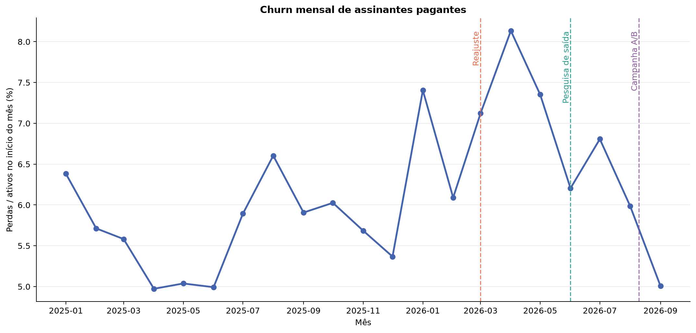
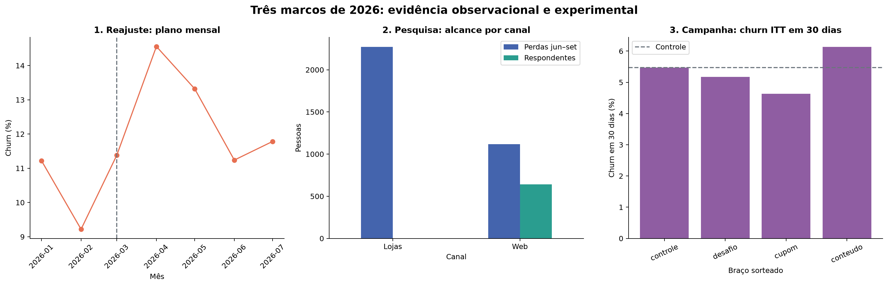
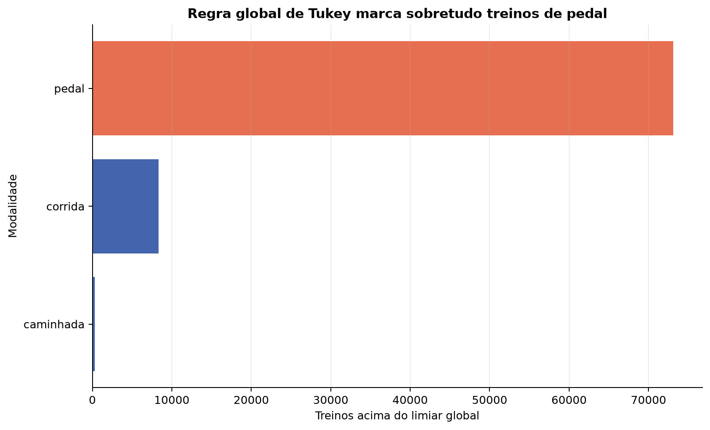
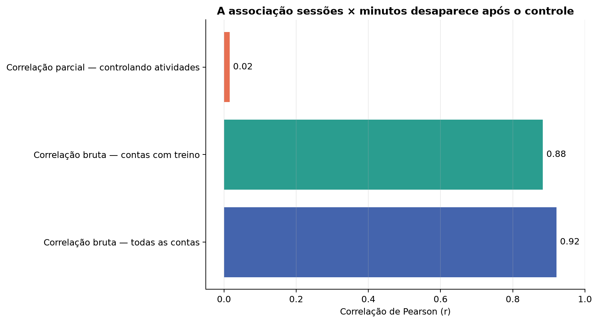

# EDA Parte 2 — Churn e Marcos de 2026

**Data de corte:** 30/09/2026
**Regra de comunicação:** 1 tabela + 1 gráfico + 3 frases por achado.

## 1. Série mensal de churn

| mes                 |   ativos_inicio |   perdas |   churn_pct |
|:--------------------|----------------:|---------:|------------:|
| 2025-01-01 00:00:00 |            8540 |      545 |        6.38 |
| 2025-02-01 00:00:00 |            9418 |      538 |        5.71 |
| 2025-03-01 00:00:00 |           10014 |      559 |        5.58 |
| 2025-04-01 00:00:00 |           10577 |      526 |        4.97 |
| 2025-05-01 00:00:00 |           10937 |      551 |        5.04 |
| 2025-06-01 00:00:00 |           11317 |      565 |        4.99 |
| 2025-07-01 00:00:00 |           11640 |      686 |        5.89 |
| 2025-08-01 00:00:00 |           11811 |      780 |        6.60 |
| 2025-09-01 00:00:00 |           12020 |      710 |        5.91 |
| 2025-10-01 00:00:00 |           12413 |      748 |        6.03 |
| 2025-11-01 00:00:00 |           12771 |      726 |        5.68 |
| 2025-12-01 00:00:00 |           13023 |      699 |        5.37 |
| 2026-01-01 00:00:00 |           13140 |      973 |        7.40 |
| 2026-02-01 00:00:00 |           13728 |      836 |        6.09 |
| 2026-03-01 00:00:00 |           14111 |     1005 |        7.12 |
| 2026-04-01 00:00:00 |           14237 |     1158 |        8.13 |
| 2026-05-01 00:00:00 |           14119 |     1038 |        7.35 |
| 2026-06-01 00:00:00 |           14102 |      875 |        6.20 |
| 2026-07-01 00:00:00 |           14059 |      957 |        6.81 |
| 2026-08-01 00:00:00 |           14032 |      840 |        5.99 |
| 2026-09-01 00:00:00 |           14319 |      717 |        5.01 |

1. **O dado diz:** a média mensal foi 5.68% em 2025 e 6.68% entre jan–set/2026; o pico observado foi 8.13% em 04/2026, com 1,158 perdas.
   **Reconciliação:** a reconstrução por `assinatura_expirada` harmonizada para Brasília fica próxima das referências executivas de 5,6%, 6,6% e 1.154 perdas em abril, mas observa 5,68%, 6,68% e 1.158. A diferença de quatro casos em abril é preservada como divergência de definição, não ajustada artificialmente.
2. **O dado não diz:** a coincidência temporal com preço, sazonalidade ou campanha não identifica causalidade isoladamente.
3. **Próxima pergunta:** quais perfis comportamentais concentram a alta de 2026 sem usar churn para formar os segmentos?

## 2. Três marcos de 2026

### 2.1 Reajuste de 01/03

| mes                 |   ativos_inicio |   perdas |   churn_pct |
|:--------------------|----------------:|---------:|------------:|
| 2026-01-01 00:00:00 |            6015 |      675 |       11.22 |
| 2026-02-01 00:00:00 |            6303 |      581 |        9.22 |
| 2026-03-01 00:00:00 |            6483 |      738 |       11.38 |
| 2026-04-01 00:00:00 |            6430 |      936 |       14.56 |
| 2026-05-01 00:00:00 |            6149 |      819 |       13.32 |
| 2026-06-01 00:00:00 |            5988 |      673 |       11.24 |
| 2026-07-01 00:00:00 |            5847 |      689 |       11.78 |

1. **O dado diz:** no plano mensal, a média de churn passou de 10.22% em jan–fev para 12.97% em mar–abr.
2. **O dado não diz:** o desenho antes/depois mistura reajuste, sazonalidade, composição de coortes e proximidade de renovação; não estima elasticidade causal.
3. **Próxima pergunta:** o efeito aparente persiste ao comparar coortes e controlar tempo de casa, canal e vencimento?

### 2.2 Pesquisa de saída a partir de 01/06

| grupo_canal   |   perdas |   respondentes |   cobertura_aparente_pct |
|:--------------|---------:|---------------:|-------------------------:|
| Lojas         |     2271 |              0 |                     0.00 |
| Web           |     1118 |            641 |                    57.33 |

1. **O dado diz:** houve 3,389 expirações entre junho e setembro e 641 respondentes únicos; 288 respondentes únicos (289 respostas) ainda estavam ativos no corte.
2. **O dado não diz:** motivos declarados por usuários Web que optaram por responder não representam automaticamente perdas nas lojas nem causas de churn.
3. **Próxima pergunta:** como combinar motivos declarados com comportamento prévio sem criar vazamento ou generalização indevida?

### 2.3 Campanha randomizada de 10/08

| grupo    |   sorteados |   perdas_30d |   abriu_push_pct |   abriu_email_pct |   clicou_pct |   churn_30d_pct |   diferenca_vs_controle_pp |   p_valor_vs_controle |
|:---------|------------:|-------------:|-----------------:|------------------:|-------------:|----------------:|---------------------------:|----------------------:|
| conteudo |        3554 |          218 |           32.048 |            17.980 |       14.913 |           6.134 |                      0.658 |                 0.235 |
| controle |        3579 |          196 |            0.000 |             0.000 |        0.000 |           5.476 |                      0.000 |                 1.000 |
| cupom    |        3472 |          161 |           31.596 |            18.980 |       16.446 |           4.637 |                     -0.839 |                 0.108 |
| desafio  |        3515 |          182 |           30.612 |            18.378 |       14.310 |           5.178 |                     -0.299 |                 0.576 |

1. **O dado diz:** no horizonte completo de 30 dias, o menor churn ITT foi do braço `cupom` (4.64%), diferença de -0.84 p.p. frente ao controle (p=0.108); nenhuma comparação atingiu significância de 5%.
2. **O dado não diz:** abertura e clique são pós-tratamento e não podem ser usados para definir causalmente quem foi persuadido; o data room não oferece 60 dias completos após 10/08.
3. **Próxima pergunta:** os intervalos e o tamanho amostral sustentam heterogeneidade por segmento em um holdout adequado?

## 3. Outliers por modalidade

| modalidade   |   treinos |   mediana_km |   outliers_regra_global |   pct_marcado_global |
|:-------------|----------:|-------------:|------------------------:|---------------------:|
| pedal        |     93406 |        25.66 |                   73120 |                78.28 |
| corrida      |    381902 |         6.47 |                    8355 |                 2.19 |
| caminhada    |    204332 |         5.22 |                     300 |                 0.15 |

1. **O dado diz:** a regra global de Tukey usa limiar de 17.08 km e marca 81,775 treinos; 73,120 são pedal.
2. **O dado não diz:** distância alta não é automaticamente erro; uma regra global confunde modalidades com escalas físicas distintas.
3. **Próxima pergunta:** quais limites de validade e dispersão devem ser definidos dentro de cada modalidade antes da segmentação?

## 4. Correlação controlada

| metrica                                     |     n |     r |
|:--------------------------------------------|------:|------:|
| Correlação bruta — todas as contas          | 56565 | 0.921 |
| Correlação bruta — contas com treino        | 15685 | 0.883 |
| Correlação parcial — controlando atividades | 15685 | 0.015 |

1. **O dado diz:** entre contas com treino, r(sessoes, minutos) é 0.88; após controlar linearmente o número de atividades, cai para 0.02.
2. **O dado não diz:** abrir o aplicativo mais vezes causa aumento de minutos; ambas as métricas refletem principalmente quantos treinos foram feitos.
3. **Próxima pergunta:** quais variáveis mantêm sinal próprio após controle por volume de atividade e tempo de exposição?

## Limitações

- A Prata de assinaturas é usada apenas para identidade, início e atributos contratuais do retrato; o evento terminal vem da Prata de eventos harmonizada para Brasília.
- A série começa em 2025, período integralmente coberto pelo log iniciado em 01/07/2024.
- O reajuste é análise observacional; somente a campanha randomizada permite interpretação causal ITT no horizonte observado.
- A pesquisa de saída possui viés de canal e seleção; respostas de usuários ainda ativos não equivalem a perdas concluídas.
