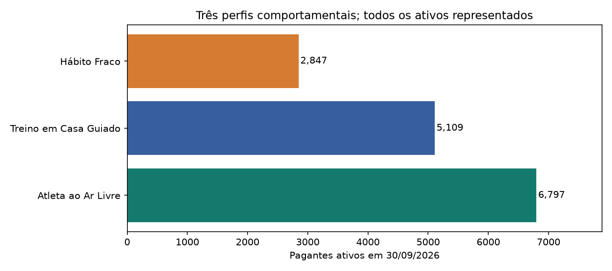
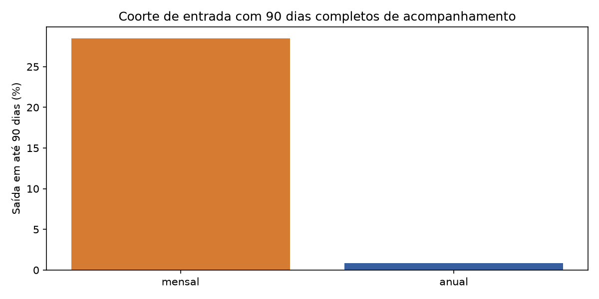
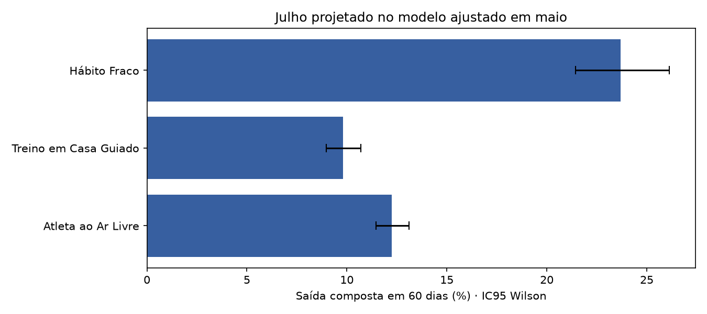
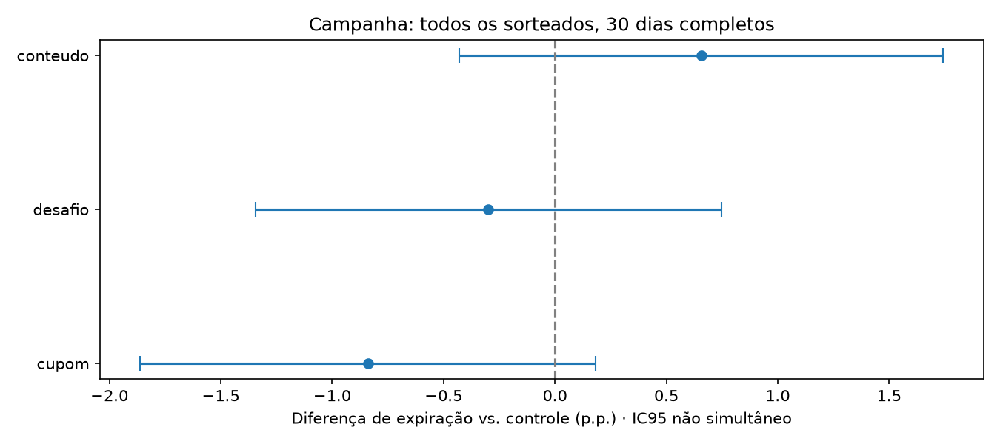
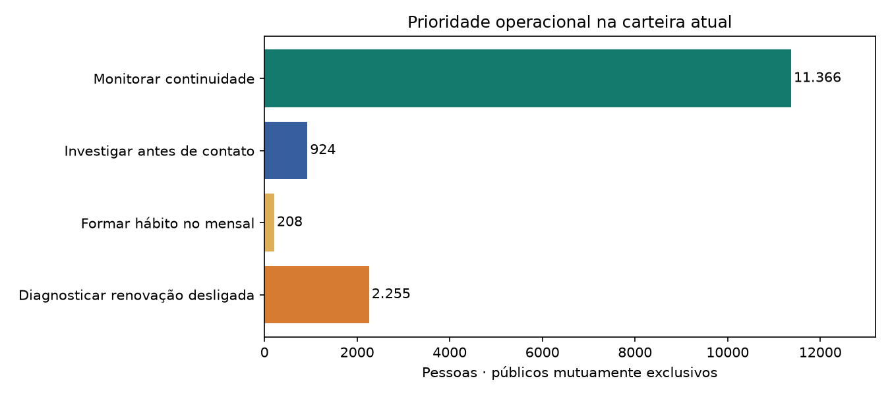

# Mini deck — versão consolidada

> Cinco slides. Abrir `semana5_consolidada/mini_deck.html`; tabelas completas no relatório.

---

## Três perfis para orientar a retenção

A carteira tem 14.753 pagantes; a segmentação usa cinco atributos em 84 dias, sem churn.

O churn mensal subiu de 5,68% em 2025 para 6,68% em jan–set/2026; a série não isola o efeito do preço.

Os grupos descrevem comportamento; não são tipos humanos fixos nem scores de risco.

| Perfil                |   Ativos |   Provisórios |
|:----------------------|---------:|--------------:|
| Atleta ao Ar Livre    |    6.797 |           524 |
| Treino em Casa Guiado |    5.109 |           387 |
| Hábito Fraco          |    2.847 |           208 |

---

## Qualidade muda a interpretação

Bronze preservada; exposição e ausência de cobertura são diferentes de zero uso.

A coorte de entrada inclui todos com 90 dias completos, mesmo quem saiu cedo; não é churn mensal.

A pesquisa cobre Web: 353 respondentes entre 3.389 saídas desde junho, cerca de 10,4%.

| Plano   |   Pessoas |   Saídas em 90 dias | Saída em 90 dias (%)   |
|:--------|----------:|--------------------:|:-----------------------|
| mensal  |    11.778 |               3.353 | 28,47                  |
| anual   |     7.308 |              63     | 0,86                   |

---

## Hábito fraco concentra maior taxa, mas não todas as saídas

Julho foi projetado no modelo de maio; atributos anteriores aos 60 dias de acompanhamento.

O alvo inclui perda de acesso ou renovação desligada, entre quem renovava no início.

A leitura é histórica, sob as campanhas do período; não é previsão para setembro nem efeito causal.

| Perfil                |   Pessoas | Taxa (%)   | Cobertura das saídas (%)   |
|:----------------------|----------:|:-----------|:---------------------------|
| Atleta ao Ar Livre    |     5.957 | 12,25      | 49,73                      |
| Treino em Casa Guiado |     4.458 | 9,80       | 29,77                      |
| Hábito Fraco          |     1.27  | 23,70      | 20,50                      |
| Base                  |    11.685 | 12,56      | 100,00                     |

---

## A campanha exige distinguir intenção e perda financeira

ITT: todos os sorteados, expiração em 30 dias; ICs individuais e p ajustado para três contrastes.

Os intervalos incluem zero; isso não comprova ausência de efeito ou equivalência.

Desfecho composto, planos e 51 dias são sensibilidades exploratórias, sem identificação de uplift individual.

| Braço    |   Pessoas | Taxa (%)   | Diferença (p.p.)   | p ajustado   |
|:---------|----------:|:-----------|:-------------------|:-------------|
| controle |     3.579 | 5,48       | 0,00               | —            |
| cupom    |     3.472 | 4,64       | -0,84              | 0,32         |
| desafio  |     3.515 | 5,18       | -0,30              | 1,00         |
| conteudo |     3.554 | 6,13       | 0,66               | 0,71         |

---

## Priorizar diagnóstico e aprender antes de ampliar

Renovação desligada exige diagnóstico; mensal com hábito fraco pode receber teste de formação de rotina.

Piloto editorial proposto: 200 e-mails e 200 controles, custo R$ 2; não comprova pequenos efeitos.

Validar elegibilidade e danos; ampliar com efeito e economia sustentáveis. Cenários não são retorno observado.

| Prioridade operacional               |   Clientes | Receita equivalente (R$/mês)   |
|:-------------------------------------|-----------:|:-------------------------------|
| 1 Diagnóstico da renovação desligada |      2.255 | 51.065,27                      |
| 2 Formação de hábito mensal          |    208     | 7.344,00                       |
| 3 Investigar antes de contato        |    924     | 20.015,80                      |
| 4 Monitorar continuidade             |     11.366 | 327.126,01                     |

