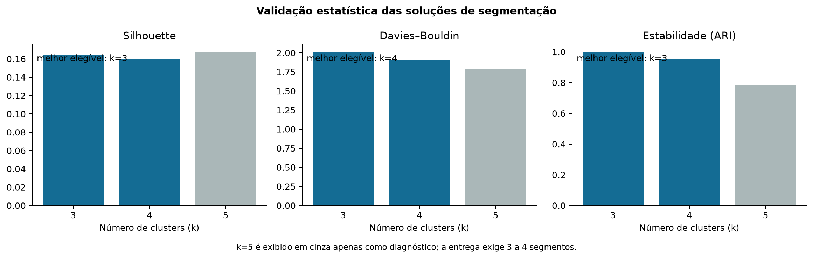
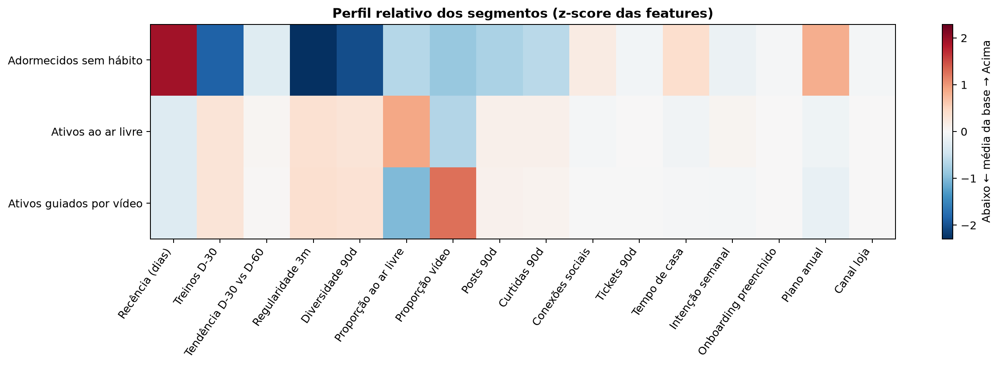
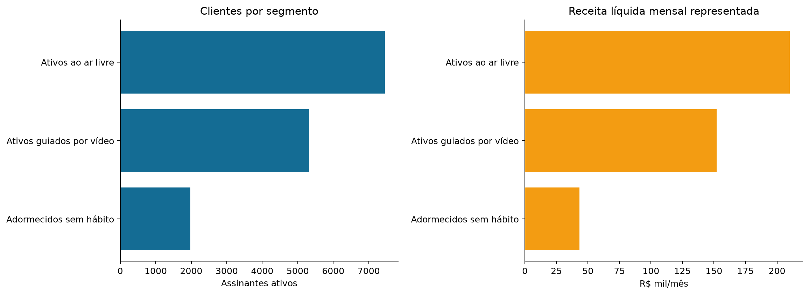
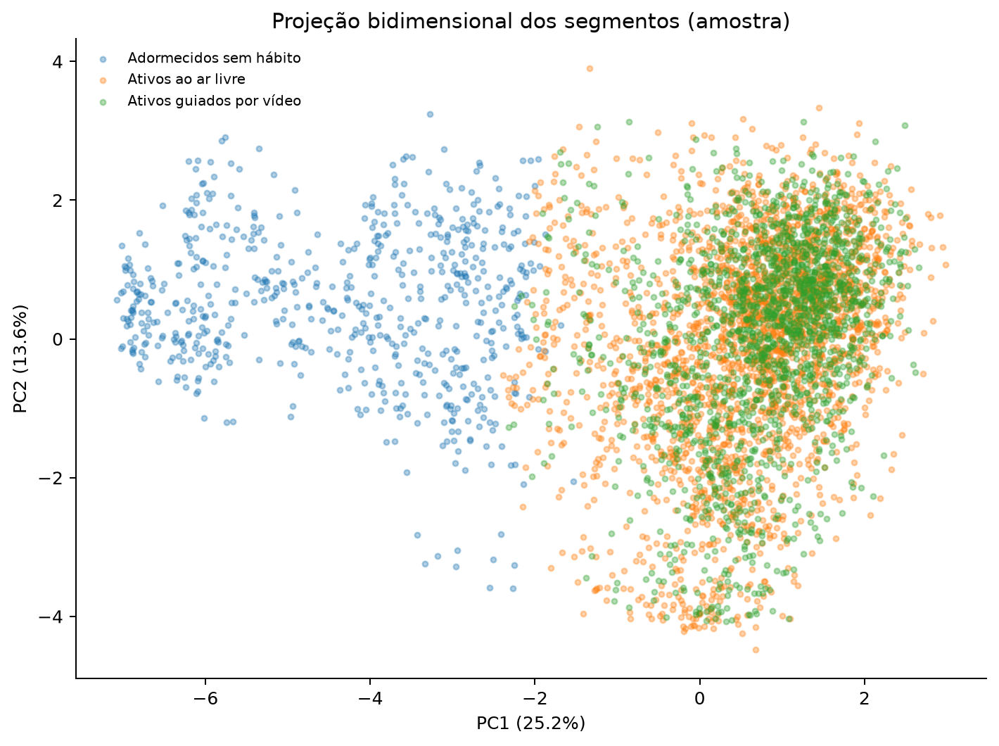

# Segmentação dos Pagantes Ativos — Etapa 4

**Data de corte:** 30/09/2026
**População:** 14.753 pagantes ativos
**Método:** K-Means sobre atributos comportamentais, sociais, contratuais e de necessidade; sem churn ou informação de saída.

## 1. Escolha do número de segmentos

|   k | elegivel_entrega   |   silhouette_amostra |   calinski_harabasz |   davies_bouldin |   estabilidade_ari |   menor_cluster_pct |    inercia |
|----:|:-------------------|---------------------:|--------------------:|-----------------:|-------------------:|--------------------:|-----------:|
|   3 | sim                |                0.164 |            2949.429 |            2.007 |              0.998 |              13.414 | 168615.047 |
|   4 | sim                |                0.160 |            2625.506 |            1.898 |              0.954 |              12.947 | 153873.695 |
|   5 | diagnostico        |                0.167 |            2341.136 |            1.784 |              0.786 |               8.703 | 144374.568 |

A solução selecionada possui **k=3**, silhouette amostral de **0.164**, Davies–Bouldin de **2.007**, estabilidade média ARI de **0.998** e menor segmento com **13.4%** da base.

## 2. Perfil dos segmentos

|   cluster_id | segmento                 |    n |   receita_liquida_mensal |   recencia_mediana_dias |   treinos_30d_mediana |   treinos_90d_mediana |   minutos_3m_mediana |   regularidade_3m_media |   diversidade_90d_mediana |   prop_ar_livre_3m_media |   prop_video_3m_media |   prop_treinos_dupla_90d_media |   posts_90d_media |   conexoes_sociais_mediana |   tickets_90d_media |   tenure_mediana_meses |   plano_anual_pct |   canal_loja_pct |   renovacao_desligada_pct |   pct_base |   receita_liquida_media_cliente | modalidade_principal   |
|-------------:|:-------------------------|-----:|-------------------------:|------------------------:|----------------------:|----------------------:|---------------------:|------------------------:|--------------------------:|-------------------------:|----------------------:|-------------------------------:|------------------:|---------------------------:|--------------------:|-----------------------:|------------------:|-----------------:|--------------------------:|-----------:|--------------------------------:|:-----------------------|
|            0 | Ativos ao ar livre       | 7457 |                209995.60 |                    2.00 |                 10.00 |                 26.00 |               703.00 |                    0.96 |                      4.00 |                     0.82 |                  0.18 |                           0.01 |              1.66 |                       3.00 |                0.04 |                   8.11 |             52.50 |            70.82 |                      9.47 |      50.55 |                           28.16 | corrida                |
|            1 | Adormecidos sem hábito   | 1979 |                 43351.69 |                   68.00 |                  0.00 |                  1.00 |                 0.00 |                    0.12 |                      1.00 |                     0.21 |                  0.09 |                           0.00 |              0.58 |                       3.00 |                0.03 |                  11.50 |             98.23 |            67.76 |                     59.63 |      13.41 |                           21.91 | sem_treino_90d         |
|            2 | Ativos guiados por vídeo | 5317 |                152203.80 |                    2.00 |                 10.00 |                 26.00 |               522.00 |                    0.97 |                      4.00 |                     0.08 |                  0.92 |                           0.01 |              1.63 |                       3.00 |                0.04 |                   8.34 |             49.26 |            70.28 |                      6.85 |      36.04 |                           28.63 | hiit                   |

## 3. Validação nos cinco critérios de negócio

| criterio      | avaliacao              | evidencia                                                                                                         |
|:--------------|:-----------------------|:------------------------------------------------------------------------------------------------------------------|
| Mensurável    | Atende                 | Tamanho, participação e receita calculados para os 14.753 ativos.                                                 |
| Substancial   | Atende                 | Menor grupo representa 13.4% da base.                                                                             |
| Diferenciável | Atende com ressalva    | Silhouette=0.164; interpretar junto aos centroides.                                                               |
| Acessível     | Atende                 | Todos são assinantes ativos alcançáveis por canais próprios; canal de cobrança é perfilado.                       |
| Acionável     | Atende preliminarmente | Recência, hábito, modalidade, social e suporte permitem hipóteses distintas; ações serão formalizadas na Etapa 5. |

## 4. Regras de governança

- A clusterização não usa churn, status de saída, pesquisa de saída, campanha, abertura, clique ou fatos posteriores ao corte.
- Idade, sexo, UF e outras variáveis demográficas são mantidas apenas para auditoria de representação; não determinam os grupos.
- `renovacao_automatica` é exibida somente após a formação dos clusters e não entra na distância do algoritmo.
- Os nomes são interpretações executivas de centroides e não estereótipos individuais.
- Segmentos descrevem semelhança; não demonstram causalidade nem substituem o modelo de risco da Semana 10.
